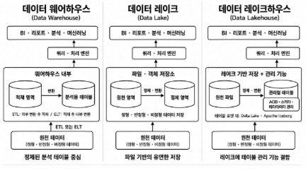
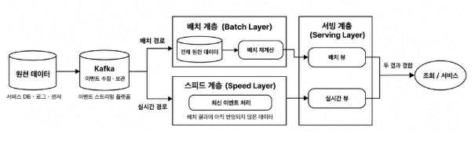
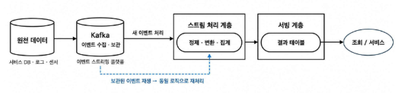

# 10월 27일

# 데이터 파이프라인과 WSL

### **데이터란?**
- 정보 vs 데이터
    - 과거에는 저일되고 유의마하게 도움되는 '정보'가 상대적으로 더 중요했음
    - 그러나 현재는 과거보다 다양한 원시 데이터를 대규모로 수집, 보관하고 새로운 목적으로 재활용하기 쉬워짐

### **데이터의 중요성**
- 데이터가 중요해진 이유?
    - 빅데이터: 데이터의 양(Volume), 다양성(Variety), 증가 속도 향상(Velocity) + 신뢰성(Veracity), 가치(Value)
    - 데이터를 수집, 가공, 활용할 수 있는 기술의 대두 => 데이터 파이프라인

- 데이터는 어디에 쓰일까?
    - 비즈니스 리더들의 의사 결정
    - 데이터를 통한 서비스/제품 강화

### **데이터 엔지니어링의 주요 활동**
- 주요 역할
    - 데이터를 안정적으로 수집하고 가공하여 전달
    - 부석과 모델링이 가능하도록 데이터 흐름을 자동화
    - 신뢰성 있고 재사용 가능한 파이프라인 구축

- 주로 하는 일
    - 다양한 시스템에서 데이터 수집
    - 정제 및 변환 (ETL/ELT 설계)

### **데이터 파이프라인**
- 데이터 파이프라인이란?
    - 데이터를 추출하고 정제하고 저장, 분석, 시각화하는 일련의 자동화 과정

### **OLAP와 OLTP**
- OLAP (Online Transaction Processing)
    - 운영 데이터 처리 시스템
    - 실시간 트랜잭션 (주문, 결제, 예약 등) 처리
    - 행 (Row) 단위 저장 구조 많음
    - 빠른 입력, 수정, 삭제에 최적화
    * 이러한 작업은 빠르게 처리 되어야 한다.
    * 클라이언트 딴에 더 가깝다

- OLAP (Online Analytical Processing)
    - 분석 데이터 처리 시스템
    - OLTP 등에서 수집된 데이터를 기반으로 통계·리포트 분석
    - OLAP 시스템은 분석 성능을 위해 컬럼 기반 저장 구조를 사용하는 경우가 많음 (OLAP = 컬럼DB는 아님)
    - 집계, 요약, 예측 분석에 최적화

* 업무와 처리 특성의 따른 구분 운영 vs 분석

### **ETL의 구조**
- ETL이란?
    - 데이터를 가공후 저장하는 전통적인 방식
    - 추출 $\rightarrow$ 가공 $\rightarrow$ 저장
    * DatawareHouse

### **ELT의 구조**
- ELT란?
    - 클라우드 시대에 많이 쓰이는 방식 (온프레미스에서도 사용)
    - 추출 $\rightarrow$ 저장 $\rightarrow$ 가공
    * DataLake

* 적재하기 전에 전처리를 하느냐? OR 원본을 살리느냐? 의 차이이다.
* 상황에 따라 적절하게 사용하는 것이 좋다.
* Lake : 정형, 비정형 구분 없어 다 때려박음
* Ware : 스키마가 존재함. SQL 같은 구문으로 데이터를 불러옴

### **데이터 처리 방식 - 베치와 스트리밍**
- 배치 처리 방식
    - 데이터를 모아서 한 번에 처리하는 방식
    - 주로 하루 1회, 또는 시간 단위로 처리가 이루어진다.
    - 대량 처리에 적합함

- 데이터 스트리밍 처리 방식
    - 데이터가 들어오는 즉시 실시간 처리하는 방식
    - 빠르게 변화하는 데이터에 즉시 반응 가능
    - 실시간 분석과 대응이 가능

* 배치는 유한한 데이터 묶음을 처리
* 스트리밍은 계속 들어오는 데이터를 지속 처리
* 데이터의 속도·목표에 따라 적절한 방식을 선택

### **데이터 파이프라인의 기본 구조**
- 자동화된 데이터 흐름
    - 데이터 소스 $\rightarrow$ 수집 $\rightarrow$ 가공 $\rightarrow$ 저장 $\rightarrow$ 분석/제공

### **데이터 저장소**
- 데이터 저장소 종류
    - 데이터 웨어하우스 : 분석에 적합하도록 정제하고 구조화한 데이터를 통합하여 저장하는 시스템
    - 데이터 레이크 : 원본 데이터에 가까운 데이터를 대규모로 저장하는 구조, 수집 후 재가공하여 활용
    - 데이터 마트 : 특정한 목적ㅇ을 위해 필요한 데이터만 별도로 구성한 소규모 북석 데이터 저장소

### **데이터 웨어하우스의 구성**
- 데이터 웨어하우스
    - 정형 데이터 중심
    - 스키마 사전 정의
    - 전통적으로 ETL 기반의 처리 방식

### **데이터 레이크**
- 데이터 웨어하우스와의 차이
    - 데이터 웨어하우스는 최종 사용자가 보고싶은 관점별 데이터 구성을 위해 원천 DB로부터 데이터를 수집
    - 스키마 관리와 품질 관리를 통해 리포트를 제공하는 시스템
    - DW는 데이터 구조가 이미 결정되어 엄격한 스키마 관리가 필요하고 한 번 구축 시 변경이 어려움
    * 정제된 데이터를 저장

### **데이터 레이크의 구성**
- 데이터 레이크
    - 다양한 형태의 원천 데이터를 유연하게 저장하고, 필요에 따라 정제 및 활용하는 저장소
    - 분석, 모델링, BI 모두 대응하는 형태
    * 원형 데이터를 저장

### **데이터 레이크하우스**
- 데이터 레이크하우스의 구성
    - 정형 + 비정형 데이터 모두 저장
    - 대용량 로그/센서 데이터 수용 가능
    - ACID 트랜잭션을 지원하여 데이터 일관성을 보장
    - 레이크의 유연한 저장 기반에 ACID 트랜잭션, 스키마 관리, 테이블 관리 기능을 결합한 구조

* Delta Lake, IceBerg

### **데이터 저장 및 분석 아키텍쳐의 중요성**
- 분석과 활용을 위한 데이터 구조 설계
    - 아키텍처에 따라 달라지는 처리 방식과 데이터 활용 범위
    - 데이터 특성과 목적에 적합한 아키텍처 선택 필요

## *데이터 파이프라인 설계*
### **아키텍처 설계**
- 데이터 엔지니어 관점에서 데이터 아키텍처 주 관심사는 파이프라인 설계
- 데이터 수집부터 분석/시각화 환경까지 데이터를 견고하게 전달하 수 있는 아키텍쳐 설계를 목표로 함

### **파이프라인 설계**
- 파이프라인 설계는 환경마다 다르기에 정답은 없음
- 온프레미스 vs 클라우드
- 요구사항에 따라 각양각색으로 구현 가능하나, 실시간 수집이 필요한지 여부에 따라 파이프라인 설계 구분 가능

- 람다 아키텍처 & 카파 아키텍처
    - 실시간 수집이 필요한 경우 참조할 수 있는 아키텍처가 존재한다.
    - 대표적으로 람다(Lambda) 아키텍처와 카파(Kappa) 아키텍처가 존재

- 람다 아키텍처
    - 2011년에 제시된 아키텍처
    - 실시간 수집이 필요한 경우 배치 처리와 스트림 처리를 모두 이용가능
    - 원천에서 발생하 이벤트를 Kafka와 같은 이벤트 스트리밍 플랫폼으로 수집·보관하며, 보관된 이벤트를 재생해 같은 스트림 처리 로직으로 재처리

- Serving Layer
    - 배치 Layer에 저장된 데이터를 빠르게 보여주기 위한 서비스 계층
    - 사용자가 쿼리할 수 있도록 함
    - 필요에 따라 스피드 Layer에 있는 데이터를 결합하기도 함

- 배치 Layer & 스피드 Layer
    - 배치 결과에 아직 반영되지 않은 최신 데이터를 스피드 Layer에서 처리
    - 배치 Layer에서 테이블 갱신이 완료되면 스피드 Layer는 그 이후 데이터부터 저장 및 정제
    - 람다 아키텍처는 컨셉만 제공

- 카파 아키텍처
    - 배치 Layer를 제거하되 배치 Layer에서 하던 일을 모두 스트림 Layer에서 수행하는 구조
    (전처리 후 필요한 테이블로 재구성)
    - 원천에서 발생한 이벤트를 Kafka 같은 이벤트 스트리밍 플랫폼으로 수집·보관하며, 보관된 이벤트를 재생해 같은 스트림 처리 로직으로 재처리
    - 그러나 일반적으로 배치 파이프라인도 많이 활용

- 람다 아키텍처나 카파 아키텍처만 가능한가?
    - 구조화된 아키텍처는 참고를 위한 아키텍처일 뿐 모든 데이터를 해당 아키텍처 기반의 파이프라인으로 만들 필요는 없다.
    - 아키텍처 수용 여부는 파이프라인마다 데이터의 활용 요건으로 결정
    - 데이터 활용 요건을 분석 후 아키텍처를 따를지 어떤 데이터 뷰를 활용할 지 결정

## 리눅스
### **리눅스**
- 유닉스(UNIX)
    - 리눅스가 탄생하기 이전 대표적으로 사용된 운영체제(OS)
    - 지금도 많이 사용되는 운영처제 중 하나이지만 높은 비용 지불 필요

- 리눅스(Linux)
    - 무료(Free) 유닉스 개념
    - 유닉스의 설계 철학과 인터페이스를 따르는 오픈소스 Unix-like 운영체제

### **리눅스의 구성**
- 커널 (Kernel)
    - 운영체제 핵심 구성 요소로, 하드웨어와 응용 프로그램 사이를 중재하는 역할을 한다.

- 리눅스 커널의 역사
    - 리누스 토르발스가 1991년, 리눅스 커널 0.01 버전을 개발
    - 1991년, 0.02 버전 소스를 공개하며 오픈소스 운동 본격화 -> 리눅스의 시작
    - 리눅스 배포판은 토르박스가 만든 커널 + 다양한 오픈소스 프로그램으로 구성

### **리눅스의 장점**
- 무료 & 오픈소스
    - 누구나 자유롭게 사용, 수정, 배포 가능
    - 라이선스 비용 부담 없이 교육/개발에 적합

- 가볍고 빠른 성능
    - 구형 하드웨어에서도 작동 가능
    - 불필요한 GUI 없이 CLI 중심 운영 가능

- 서버로서의 점유율
    - 전 세계 웹 서버의 많은 곳에서 리눅스 기반 운영
    - 클라우드, 데이터센터, 웹 호스팅에서 필수 OS

- 개발 환경
    - GIT, Docker, Python, Node.js 등 대부분 리눅스 친화적
    - 패키지 설치, 자동화, 백엔드 개발에 최적

### **우분투 리눅스**
- 우분투 리눅스
    - 데비안 기반 배포판, 다양한 플래버
    - 릴리스 주기 : 일반 버전 (6개월), LTS 버전 (2년)

### **chmod**
- 리눅스 권한 구조
    - 리눅스에서는 각 파일/디렉토리에 대해 다음 3가지 주체에 대한 권한을 따로 설정할 수 있다.

- 주체
    - u(user) - 파일의 소유자
    - g(group) - 파일이 속한 그룹
    - o(other) - 그 외 사용자

- 권한
    - r(read) - read(내용 보기 가능)
    - w(write) - write(수정 가능)
    - x(excute) - excute(실행가능, 디렉토리 접근 포함)

    