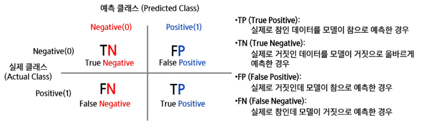
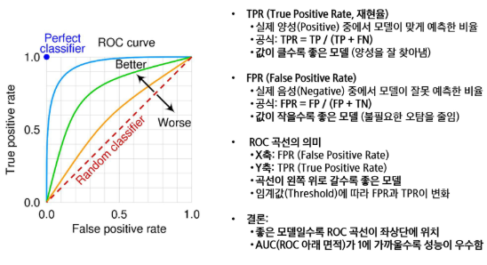

# 10월 13일 화요일

# 머신러닝
기계 학습은 컴퓨터가 명시적으로 프로그래밍되지 ㅇ낳아도 스스로 학습할 수 있는 능력을 부여하는 학문 분야이다. - Arthur Samuel  

컴퓨터 프로그램이 어떤 작업 집합 T와 성능 척도 P에 대해 경험 E로부터 학습한다고 할 때, 경험 E를 통해 T 작업에 대한 성능이 P로 측정한 결과 향상되는 경우를 말한다. - Tom Mitchell

### **피처 엔지니어링이란?**
- 모델이 더 좋은 예측을 할 수 있도록 데이터를 가공하는 과정
- 데이터를 단순히 수집하는 것보다 적절한 피처(Feature, 변수)를 만드는 것이 성능 향상에 중요

### **피처 엔지니어링 필요성**
- 원본 데이터는 모델이 바로 이해하기 어려운 형태일 수 있음
- 좋은 피처를 만들면 복잡한 모델 없이도 높은 성능을 낼 수 있음
- 불필요한 변수를 제거하면 연산 속도가 빨라지고 해석력이 향상됨

### **피처 선택**
- 모델 성능에 중요한 변수만 선택하고 불필요한 변수 제거
- 방법
    - 상관계수 분석 -> 상관관계가 높은 변수 제거
    - 분산 기반 선택 -> 변화가 거의 없는 변수 제거
    - Recursive Feature Elimination(RFE) -> 모델 성능에 가장 중요한 변수 선택

### **피처 생성**
- 기존 데이터를 활용하여 새로운 변수를 만드는 과정
- 예시
    - 날짜 데이터 -> "요일", "주말 여부", "계절" 변수 추가
    - 판매 데이터 -> "가격 X 판매량" 으로 매출 변수 생성

### **피처 변환**
- 모델이 데이터를 더 잘 학습할 수 있도록 변형
- 방법
    - 정규화 (Normalization) : 값의 범위를 [0,1]로 조정
    - 표준화 (Standardization) : 평균 0, 표준편차를 1로 조정
    - 로그 변환 (Log Transformation) : 데이터 분포를 정규분포에 가깝게 변형

### **범주형 데이터 인코딩**
- 문자 데이터를 숫자로 변환하여 모델이 이해할 수 있도록 함
- 방법
    - 원-핫 인코딩 : 카테고리를 0과 1로 변환
    - 라벨 인코딩 : 카테고리를 숫자로 변환 (ex : "red" -> 1 , "blue" -> 2)

### **결측값 처리**
- 데이터에서 비어있는 값(결측치)을 처리하는 과정
- 방법
    - 삭제 : 결측치가 적으면 해당 행 제거
    - 대체 : 평균, 중앙값, 최빈값으로 채우기
    - 예측 모델 사용 : 머신러닝을 활용하여 결측값 예측

### **이상치 처리**
- 극단적인 값을 감지하고 처리하는 과정
- 방법
    - Z-score, IQR(사분위 범위) 기반 이상치 제거
    - 로그 변환으로 이상치 영향을 줄이기

### **머신러닝의 종류**
- Supervised Learning(지도학습)
- Unsupervised Learning(비지도학습)
- Reinforcement Learning(강화학습)

### **지도 학습**
- 집 가격 예측
    - n개의 샘플을 포함한 데이터셋이 주어졌을 때,
    - Task : 주거지가 x 평방피트일 때, 그 가격을 예측하라

    - 추가 정보 : 대지 크기를 알고 있다고 가정
    - Task : (면적, 대지크기) -> 가격으로 매핑하는 함수를 찾아라

    - 만약 우리가 많은 데이터를 갖고 있다면   
    -> 많은 Feature를 갖고 있다면 더 정확한 예측이 가능할까?  
    -> 그건 확답할 수 없다.

### **비지도 학습**
- 데이터셋에 라벨이 없음 : x_1, --- , x_n
- 목표(모호하게 제시됨) : 데이터에서 흥미로운 구조를 발견하는 것

ex)  
- 유전자 클러스터링 

### **자기지도학습**
- Large Language Model
    - 대규모 언어 데이터셋을 통해 학습된 기계 학습 모델
    - 다양한 목적으로 활용 가능

    - 지도 학습의 단점인 정답 데이터에 대한 한계를 극복 - 정답이 없는 데이터에도 자체 데이터로 학습
    - 사전 학습(Pre-training)과 미세조정(Fine-tuning) 단계로 진행

### **강화학습**
- 순차적인 결정을 내리는 학습
- 행동 -> 환경 -> 보상 -> 에이전트

### **회귀란 무엇인가?**
- 회귀
    - 회귀는 연속적인 숫자 값을 예측하는 지도 학습의 한 유형
    - 입력 데이터를 기반으로 특정 연속적 목표 값(출력)을 예측하는 것이 목적
- 회귀 문제의 목표
    - 입력 변수(특징)를 사용하여 출력 값의 추세를 학습하고, 이를 기반으로 새로운 데이터에 대해 예측을 수행
- 회귀의 활용 예시
    - 주택 가격 예측 : 집의 크기, 위치, 연도 등의 정보를 바탕으로 가격을 예측
    - 주식 시장 분석 : 과거 주가 데이터를 바탕으로 미래 주가를 예측
    - 날씨 예측 : 기온, 습도, 풍속 등의 데이터를 사용해 내일의 기온을 예측
- 회귀와 분류의 차이점
    - 회귀는 연속적인 값을 예측하는 문제(예 : 온도, 가격)
    - 분류는 이산적인 범주를 예측하는 문제 (예 : 스팸/비스팸, 고양이/개)

### **입력 변수 (Features, 독립 변수)**
- 회귀 문제에서 입력 변수는 예측에 필요한 다양한 특성을 의미
- 입력 변수는 하나일 수도 있고, 여러 개일 수도 있음
- 예
    - 주택 가격 예측에서의 입력 변수 : 주택 크기, 위치, 방, 개수 등

### **출력 변수 (Target, 종속 변수)**
- 회귀 문제의 출력은 예측하고자 하는 연속적인 값
- 출력 변수는 모델이 학습하여 예측하는 목표 값
    - 주택 가격 예측에서의 출력 변수 : 예측된 주택의 가격
    - 자동차 연비 예측에서의 출력 변수 : 1리터당 이동할 수 있는 거리(Km/L)

### **모델의 목적**
- 입력 변수(특성)와 출력 변수(목표 값) 간의 관계를 학습해, 새로운 입력이 주어졌을 때 적절한 출력 값을 예측
- 예시 : 주택의 크기와 위치 정보를 입력으로 받아 주택 가격을 예측

### **회귀**
- Training Data를 이용해서 데이터의 특성과 상관관계 등을 파악하고, 그 결과를 바탕으로 Training Data에 없는 미지의 데이터가 주어졌을 경우에, 그 결과를 연속적인 (숫자) 값으로 예측하는 것
- 예 : 공부시간과 시험 성적 관계 등

### **회귀의 종류**
- 단순 선형회귀 : 하나의 설명 변수로 연속형 목표값을 예측, 직선으로 표현
- 다중 선형회귀 : 둘 이상의 설명 변수로 연속형 목표값을 예측, 선형적
- 다항 회귀 : 2차항 이상의 항으로 계산, 다항식
- 로지스틱 회귀 : 범주형 종속변수를 예측하는 분류 모델

## **단순 선형 회귀란?**
- 입력 변수(특성)와 출력 변수(목표 값) 간의 선형 관계를 가정하여 예측하는 모델
- 데이터가 직선으로 표현될 수 있을 때, 가장 간단하고 직관적인 방법

### **모델의 수식**
- Y = wx + b

### **예측 방법**
- 주어진 데이터를 기반으로 최적의 직선(회귀선)을 찾아 입력 값에 대한 출력 값을 예측
- 모델은 오차를 최소화하는 방향으로 직선의 기울기 w와 절편 b를 학습

### **장점**
- 해석이 용이하고 계산이 빠름
- 비교적 단순한 문제에 대해 좋은 성능을 발휘

### **단점**
- 입력 변수와 출력 변수 간의 관계가 비선형적일 경우 성능이 저하될 수 있음
- 과적합의 위험이 있으며, 다중 공선성이 있을 때 문제가 발생할 수 있음

### **사용 예시**
- 주택 가격 예측 : 주택 크기에 따른 가격 예측
- 광고 비용과 판매량의 관계 분석

## **다중 선형 회귀란?**
- 여러 개의 입력 변수(특성)를 사용하여 출력 변수를 예측하는 선형 회귀 모델
- 단일 입력 변수를 사용하는 선형 회귀와 달리, 다중 회귀는 다수의 변수를 고려하여 보다 정확한 예측 가능

### **모델의 수식**
- y = w_1 x_1 + W_2 x_2 + ... + w_n x_n + b

### **예측 방법**
- 각 입력 변수에 해당하는 가중치를 곱한 후, 그 값을 모두 더하여 예측 값을 계산
- 모델은 모든 입력 변수의 영향을 고려하여 오차를 최소화하는 방향으로 가중치와 절편을 학습

## **다항 회귀란?**
- 입력 변수와 출력 변수 간의 비선형 관계를 모델링하는 회귀 방법
- 선형 회귀와 달리, 입력 변수의 거듭제곱을 포함한 다항식을 사용하여 비선형 패턴을 학습

### **장점**
- 데이터가 비선형적인 경우, 선형회귀보다 더 나은 예측 성능을 보임
- 다양한 비선형 패턴을 유연하게 모델링할 수 있음

### **단점**
- 과적합 위험이 큼
- 특히 다항 차수가 높아질수록 모델이 복잡해져 과적합 가능성이 증가
- 데이터가 부족할 경우, 모델이 안정적이지 않을 ㅅ ㅜ있음

### **사용 예시**
- 곡선 패턴이 있는 데이터 예측 : 예를 들어, 온도, 변화에 따른 전력 사용량 예측
- 주택 가격 예측에서, 방 개수와 가격간의 비선형 관계 모델링

### **모델의 수식**
- y = w1x + w2x^2 + w3x^3 + ... + wnx^n + b

### **예측 방법**
- 입력 값 x의 거듭제곱을 사용해 곡선 형태의 관계를 모델링
- 선형 회귀로는 설명할 수 없는 비선형 패턴을 더 잘 포착 가능

## **분류란 무엇인가?**
- 분류의 정의
    - 분류는 입력 데이터가 여러 개의 카테고리 중 하나에 속하도록 지정하는 작업
    - 주로 지도 학습 방식을 ㅗ이루어지며, 데이터의 특징을 기반으로 해당 데이터가 어느 범주에 속하는지 예측

- 분류 문제의 목표
    - 학습 알고리즘은 함수 f을 생성하여 입력 벡터 x가 어떤 카테고리 y에 속하는지를 예측

- 분류 문제의 예시
    - 객체 인식 : 이미지속 사물을 인식하여 해당 사물이 무엇인지 분류하는 작업
    - 얼굴 인식 : 사진 속 인물을 인식하고 자동으로 태그하는 기술로, 사용자와 컴퓨터 간의 자연스러운 상호작용을 가능하게 함

### **분류와 회귀의 차이**
- 분류는 결과가 '카테고리'로 나타나며, 이산적인 값으로 분류
- 회귀는 결과가 '숫자'로 나타나며, 연속적인 값을 예측

## **분류**
- Training Data를 이용해서 데이터의 특성과 상관관계 등을 파악하고, 그 결과를 바탕으로 Training Data에 없는 미지늬 데이터가 주어졌을 경우에, 그 결과를 어떤 종류의 값으로 분류 될 수 있는지를 예측하는 것

### **분류 문제의 입력과 출력**
- 입력 데이터
    - 분류 문제에서 입력 데이터는 하나 이상의 특징으로 이루어진 벡터로 표현
    - 특징 벡터
        - 예 : 이미지 인식에서 이미지의 각 픽셀값
        - 입력 데이터는 연속형(숫자) 또는 이산형(범주형)값으로 구성

- 출력 데이터 
    - 분류 문제의 출력은 데이터가 속한 클래스(범주)를 나타냄
    - 출력 레이블 : y
        - 예 : 이진 분류에서 출력은 0 or 1
        - 다중 클래스 분류에서는 y가 1,2,3 등 여러 클래스를 나타냄

- 입력과 출력의 관계
    - 분류 모델은 주어진 입력 x에 대해 적절한 출력 y를 예측하는 함수 f(x)를 학습
    

### **결정 경계란?**
- 분류 모델이 데이터를 분류하기 위해 공간을 나누는 경계선
- 입력 데이터를 특징 공간에서 서로 다른 클래스의 영역으로 구분

### **결정 경계의 역할**
- 각 클래스에 속하는 데이터 포인트를 구분하는 기준을 제공
- 새로운 데이터가 주어졌을 때, 그 데이터가 어느 클래스에 속하는지 결정

### **결정 경계의 예시**
- 선형 결정 경계
    - 단순한 직선이나 평면으로 클래스 간의 경계를 나눔
- 비선형 결정 경계
    - 더 복잡한 경계를 만들어 클래스 간의 경계를 나눔

### **결정 경계 시각화**
- 2차원 특징 공간에서는 결정 경계를 쉽게 시각화 가능
- 각 클래스 영역이 어떻게 나누어져 있는지를 시각적으로 표현하면 모델의 동작을 더 쉽게 이해할 수 있음

### **분류 문제에 회귀 알고리즘 적용**
- 일반적인 회귀 알고리즘은 분류 문제에 그대로 사용할 수 없음
- 선형 회귀는 -inf ~ +inf의 값을 가질 수 있음

## **로지스틱 회귀**
- 해당 클래스에 속할 확률인 0 or 1 사이의 값만 내보낼 수 있도록 선형 회귀 알고리즘 수정하기
- 이처럼 분류 문제에 적용하기 위해 출력 값의 범위를 수정한 회귀를 로지스틱 회귀

### **로지스틱 회귀란?**
- 이진 분류를 위한 대표적인 선형 모델
- 입력 데이터를 기반으로 특정 클래스에 속할 확률을 예측
- 회귀라는 이름이 붙었지만 분류 문제에 사용

### **로지스틱 함수**
- 예측값을 0과 1사이의 확률로 변환하는 함수 (시그모이드)

### **장점**
- 해석이 간단하고 계산이 빠름
- 데이터가 선형적으로 분리될 수 있는 경우 좋은 성능

### **단점**
- 비선형 데이터에는 적합하지 않을 수 있음
- 복잡한 결정 경계를 만들기 어려움

### **로지스틱 함수**
- S자형 곡선을 가지는 함수
    - x 값이 커질 경우 g(x) 값은 점점 1에 수렴
    - x 값이 작아질 경우 g(x) 값은 점점 0에 수렴

## **결정 트리란?**
- 데이터를 feature에 따라 트리 구조로 분할하여 분류하거나 예측하는 알고리즘
- 각 노드는 특성의 조건을 기반으로 데이터를 분기하며, 최종 리프 노드는 예측 결과 클래스를 나타냄

### **작동 방식**
1. 특성 선택 : 각 특성을 기준으로 데이터를 분할할 수 있는 최적의 조건을 찾음
2. 분할 : 데이터를 해당 특성 조건에 따라 좌우로 분기함
3. 리프 노드 도달 시 각 분할된 노드가 특정 클래스로 분류될 떄까지 분할을 반복함

### **특성 선택 기준**
- 지니 지수(지니 불순도) 또는 엔트로피를 사용하여 분할의 순도를 측정
- 순도가 높을수록 (한쪽 클래스로 치우칠 수록) 해당되는 특성은 더 좋은 분할 기준(값이 작으면 좋음)

### **장점**
- 해석이 용이 : 트리 구조로 시각화가 가능하며, 결과 해석이 직관적
- 비선형 데이터에도 적합 : 복잡한 결정 경계를 만들 수 있음
- 데이터 전처리 과정이 간단하며, 범주형 데이터도 다룰 수 있음

### **단점**
- 트리가 너무 깊어지면 과적합의 위험이 있음
- 작은 변화에도 모델이 민감하게 반응할 수 있음
- 데이터가 많아질수록 성능 저하가 발생할 수 있음

- 예시
    - 고객 이탈 예측, 의사결정 지원 시스템, 의료 진단 등 다양한 분야에서 사용

## **KNN**

### **K-최근접 이웃 알고리즘이란?**
- 지도 학습에서 사용되는 간단한 알고리즘
- 데이터 포인트가 주어졌을 때, 그 데이터와 가장 가까운 k개의 이웃을 기준으로 클래스를 결정
- 기존 데이터 가운데 가장 가까운 K개 이웃의 정보로 새로운 데이터를 예측하는 방법론
- 유사한 특성을 가진 데이터는 유사 범주에 속하는 경향이 있다는 가정 하에 분류
- 설정된 k 값에 따라 가까운 거리 내의 이웃의 수에 따라 분류

### **작동 방식**
1. 거리 계산 : 새로운 데이터와 훈련 데이터 간의 거리를 계산
2. k개의 이웃 선택 : 가장 가까운 k개의 이웃을 선택
3. 다수결 투표 : 선택된 이웃 중 가장 많은 클래스에 속하는 클래스를 데이터의 클래스로 예측

### **하이퍼파라미터 k**
- k 값은 미리 정해지는 값, k가 너무 작으면 과적합
- k가 너무 크면 과소 적합

### **장점**
- 직관적이고 이해하기 쉬움
- 복잡한 결정 겅계도 학습할 수 있음

### **단점**
- 데이터가 많아지면 계산비용 많이 듦
- 차원의 저주에 취약
- 중요한 특징을 자동으로 학습하지 않으므로 Feature Engineering이 필요할 수 있음

- 예 : 이미지 인식, 추천 시스템, 패턴 인식 등

## **머신러닝 평가지표**
### **Overfiting vs Underfiting**
- Overfiting
    - 모델이 학습 데이터에 지나치게 적합하여, 복잡한 패턴까지 모두 학습
    - 학습 데이터에서는 높은 성능, 하지만 새로운 데이터에서는 성능이 저하

- Underfiting
    - 모델이 충분히 학습되지 않아 중요한 패턴조차 학습하지 못 함
    - 학습 데이터와 테스트 데이터 모두에서 성능 저조

### **평가**
- 실제값과 모델에 의해 예측된 값을 비교하여 두 값의 차이(오차)를 구하는 것
- (실제값 - 예측값) = 0 이면, 오차가 없는 것으로 모델이 100% 성능을 보임
- But 성능이 100%인 모델은 현실적으로 힘들기 때문에, 오차를 구하여 어느 정도까지 오차를 허용할 지 결정  
-> 과적합을 방지하고 최적모델을 찾기 위해서

## **회귀 모델 평가 방법**
- 하나의 목표를 가지고 다양한 회귀 모델을 만들어 테스트
- 그 중 어떤 모델이 가장 나은 모델인지 판단할 때 모델 평가지표 사용
- 실제 데이터와 예측 결과 데이터가 얼마나 비슷한 지에 기반하지만, 단순하게 이것만 가지고 판단하기에는 무리가 있음

- 방법
    - 평균 절대 오차 (MAE, Mean Absolute Error)
    - 평균 절대 백분율 오차 (MAPE, Mean Absolute Percentage Error)
    - 평균 제곱 오차 (MSE, Mean Squared Error)
    - 평균 제곱근 오차 (RMSE, Root Mean Squared Error)
    - 결정 계수 (R^2 Score)

### **R2 score = R squared**
- 모델이 실제 데이터의 변동성을 얼마나 잘 성명하는지를 나타내는 지표
- 실제 값의 전체 변동성 (SST) 중에서 모델이 설명할 수 있는 비율
- 1에 가까울 수록 좋은 모델

## **분류 모델 평가 방법**
- 하나의 목표를 가지고 다양한 분류 모델을 만들어 테스트
- 그 중 어떤 모델이 가장 나은 모델인지 판단할 때 모델 평가지표 사용

- 회귀모형과 비슷하게 실제 데이터와 예측 결과 데이터가 얼마나 비슷한 지에 기반하지만, 단수하게 이것만 가지고 판단하기에는 무리가 있음

- 방법
    - 정확도 (Accuracy)
    - 오차행렬 (Confusion Matrix)
    - 정밀도 (Precision)
    - 재현율 (Recall)
    - F1-score
    - ROC AUC

### **오차행렬**
- 분류 모델이 예측한 결과와 실제 정답을 비교하여 성능을 평가하는 방법
- 특히 이진분류 문제에서 모델이 얼마나 정확하게 예측했는지를 분석하는데 유용
    - TP(True Positive) : 실제로 참인데 참으로 예측
    - TN(True Negative) : 실제로 거짓인데 거짓으로 예측
    - FP(False Positive) : 실제로 거짓인데 참으로 예측
    - FN(False Negative) : 실제로 참인데 거짓으로 예측

### **정확도**
- 전체 샘플 중에서 모델이 맞춘 비율
- 하지만 데이터가 불균형한 경우에는 부적절할 수 있음 (예 : 99% 건강한 데이터, 1% 암 환자)
- $정확도 = \frac{TP + TN}{TP + TN + FP + FN}$

### **정밀도**
- 모델이 참이라고 예측한 것 중 실제로 참인 비율
- FP를 줄이는데 초점
- $정밀도 = \frac{TP}{TP + FP}$

### **재현율**
- 실제 참 중에서 모델이 맞춘 비율
- FN을 줄이는데 초점
- $재현율 = \frac{TP}{TP + FN}$

### **Precision과 Recall의 Trade off**
- 재현율이 중요한 경우 -> 실제 Positive를 놓치면 안 되는 상황
    - 암 진단 : 암 환자를 놓치면 치명적
    - 금융 사기 탐지 : 사기 거래를 놓치면 피해 발생

- 정밀도이 중요한 경우 -> 실제 Negative를 잘못 Positive로 예측하면 문제되는 상황
    - 스팸 필터 : 중요한 이메일을 스팸으로 분류하면 안 됨
    - 의료 검사 : 불필요한 추가 검사 (비용 증가)

- 정밀도와 재현율은 반비례 관계
- 임계값을 조정하면 정밀도 또는 재현율을 조절할 ㅅ ㅜ있음
- 하지만 정밀도를 높이면 재현율이 낮아지고, 재현율을 높이면 정밀도가 낮아지는 관계

### **정밀도를 100%로 만드는 방법**
- 확실한 경우만 Positive로 예측하고 나머지는 모두 Negative로 예측
- 결과 : FP(거짓 양성) = 0 -> 정밀도 100%
- 문제 : 대부분의 양성을 놓칠 위험 (재현율 극도로 낮아짐)

### **재현율을 100%로 만드는 방법**
- 모든 데이터를 Positive로 예측
- 결과 : FN(거짓 음성) = 0 -> 재현율 100%
- 문제 : 너무 많은 FP 발생 -> 정밀도 급락

### **F1-score
- 정밀도와 재현율의 조화 평균
$F1 - score = 2 * \frac{Precision * Recall}{Precision + Recall}$
- 정밀도와 재현율 사이에서 균형을 맞춘 지표
- 정밀도와 재현율이 어느 한쪽으로 치우치지 않는 수치를 나타낼 떄 높은 값을 가짐

### **ROC 곡선(Receiver Operating Characteristic Curve)**
- False Positive Rate(FPR) 변화에 따른 True Positive Rate (TPR) 변화를 나타내는 그래프
- x축 : False Positive Rate
- y축 : True Positive Rate
- 곡선이 왼쪽 위로 올라갈수록 좋은 모델

### **AUC (Area Under Curve)**
- ROC 곡선 아래 면적을 위미하며 1에 가까울수록 좋은 성능
- 일반적으로 의학 및 머신러닝의 이진 분류 평가 지표로 활용됨

