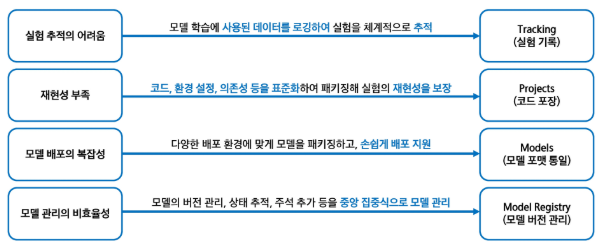

# 10월 16일 금요일

### ***MLOps***
- 머신러닝 모델의 개발과 운영을 통합하여 모델의 개발, 배포, 모니터링, 유지 보수 등의 많은 과정을 자동화하여 효율적으로 하는 기술과 방법론
- MLOps를 사용하면 조직은 ML 수명 주기 전반의 프로세스를 자동화하고 표준화 가능
- MLOps는 협업 기능이며, 주로 데이터 사이언트, DevOps 엔지니어, IT로 구성

### **기존 머신러닝 프로세스**
기존 머신러닝 프로세스의 한계점은?
- 데이터 품질과 양에 대한 의존성 문제  
-> 머신러닝 모델은 대량의 고품질 데이터를 필요로 하는데, 대부분의 실제 데이터는 노이즈와 불완전한 데이터가 많아 모델의 성능을 저하 시킴
- 특징 추출의 어려움  
-> 특정 특징을 추출하는 과정은 비용과 시간이 많이 소모
- 새로운 상황에 대한 대응 문제  
-> 머신러닝 모델이 학습한 데이터의 범위 내에서만 정확한 예측이 가능
- 모델 해석의 어려움  
-> 복잡한 모델일수록 내부 동작 방식을 이해하기 어려움
- 데이터 분포 변화에 대한 민감성  
-> 시간에 따라 변화하는 데이터의 분포에서 기존에 학습된 모델은 성능 저하를 일으킴

* 이러한 한계점을 극복하기 위해 MLOps 등의 새로운 접근법이 개발됨

### **MLOps의 필요성**
- 반복 실험의 체계화
    - 수많은 하이퍼파라미터 조합 실험
    - 데이터 전처리 방식, 피처 선택 변화
    - 실험 결과 비교를 위한 자동 기록
- 협업 효율성 향상
    - 여러 팀원이 같은 실험을 반복하지 않음
    - 실험 결과를 다른 사람과 쉽게 공유
    - 버전 관리로 변경 사항 추적 용이
- 재현성 확보
    - 실험이 시간이 지나도 재현 가능한 구조
    - 동일한 코드 + 데이터 + 환경 -> 동일한 결과
- 추적성 확보
    - 어떤 실험에 어떤 성능이 나왔는지 확인
    - 실험 조건, 환경, 결과가 모두 기록

### **MLOps 주요 단계**
- 데이터 준비
    - 데이터 수집
    - 데이터 전처리
    - 특성 엔지니어링
- 모델 학습 및 검증
    - 모델 개발
    - 모델 학습
    - 모델 검증
- 모델 배포
    - 배포 준비
    - 배포
    - 배포 전략
- 모델 모니터링 및 관리
    - 성능 모니터링
    - 데이터 드리프트 감지
    - 모델 업데이트

### **자동화 구조로서의 MLOps (CI/ CT/ CD)
- CI (Continuous Integration)
    - 코드 변경 시 자동 테스트 -> 코드 품질 보장
    - 코드(모델 스크립트, 파이프라인) 변경 시 자동을 통합 및 테스트
    - 데이터 전처리 코드, 모델 구조 변경 사항 포함
- CT (continuous Traning)
    - 데이터 변화에 따른 재학습 -> 최신 모델 유지
    - 새로운 데이터가 들어오면 모델을 자동으로 재학습
    - 정기적 스케줄 또는 이벤트 기반으로 작동
    - 실험 추적 도구 (MLFlow) 와 함께 사용시 강력함
- CD (Continuous Delivery)
    - 모델 자동 배포 -> 운영 자동화, 실시간 대응
    - 학습이 완료된 모데을 자동을 서빙 환경에 배포
    - Rest API 형태, 클라우드 환경 등 다양하게 적용 가능

### **MLFlow란?**
- MLFlow
    - MlFlow는 실험 기록, 모델 추적 및 패치징, Registry와 배포 연동을 지원하는 오픈소스 플랫폼
    - 머신러닝 모델을 만들고 실험하고 배포하기까지의 과정을 더 체계적으로 재현 가능하게 관리해주는 도구

- MLFlow의 등장 배경
    - 2018년도 Databricks에서 개발
    - 다양한 프레임워크에 독립적이고, 설치도 간편한 오픈소스
    - 실험 기록, 모델 저장, 버전 관리, 배포를 하나로 지원
    - MLFlow는 "머신 러닝 실험의 Git과 비슷한 역할" and "운영 자동화 도구"

- MLFlow의 기본 기능
    - 기존 머신러닝 운영의 문제점을 MLFlow의 핵심 기능 4가지로 해결 (Tracking, Projects, Models, Model Registry)
    - Logged Model 이라는 독립된 최상위 개념을 통해 별도 객체로 추적

    

### **MLFLow 4대 컴포넌트**
- Tracking : 머신러닝 실험에서 사용된 파라미터, 메트릭, 아티팩트 등을 기록하고 추적
- Projects : 재사용 가능한 형태로 머신러닝 코드를 패키징하여 표준 형식으로 제공
- Models : 다양한 배포 환경에 맞게 모델을 패키징 가능
- Model Registry : 모델 버전 관리, 상태 추적, 주석 추가 등을 통해 중앙 집중식으로 모델을 관리

### **MLFlow 장점**
- 협업 항상
    - 중앙 집중화된 실험 관리  
        -> MLFlow는 실험 데이터를 중아에서 관리하여, 팀원들이 실험 결과를 공유하고 협업하도록 지원
- 실험 추적 효율화
    - 자동 로깅  
        -> 모델 학습 시 사용된 파라미터, 메트릭, 아티팩트 등ㅇ 로그를 자동으로 기록하여 실험을 체계적으로 추적
- 재현성 강화
    - 환경 및 코드 패키징  
        -> MLFlow는 코드와 실행 환경을 패키징하여, 코드, 데이터, 환경을 함께 연결했을 떄 재현성에 도움
    
## MLFLow의 주요 구성 요소
- MLFLow Tracking
    - Tracking은 머신러닝 실험과 실행을 체계적으로 관리하기 위한 API와 UI를 제공하는 컴포넌트
    - Tracking은 실험의 각 실행으로 구성되며, 실험의 각 실행으로 발생하게 된다.
    - MLFlow Tracking의 기능을 통해 머신러닝 실험의 재현성, 투명성, 효율성 향상

- MLFlow Tracking의 주요 기능
    - Parameter : 모델 학습에서 실행 설정 값을 키-값 쌍으로 저장 및 추적
    - Metric (지표) : 모델의 평가 수치(정확도 등)를 숫자 형태로 저장 및 추적
    - Artifact(산출물) : 모델 파일, 이미지, 데이터 파일 등 실행 결과로 생성된 파일
    - 코드 버전(소스코드) : 실행에 사용된 GIT 커밋 해시 등을 기록하여 코드 버전을 추적
    - Tags : 실험에 대한 설명 및 분류
    - 모델은 log_models()으로 Logged Model을 만들고 Run과 연결

- MLFlow Tracking 환경 구성 요고 3 가지
    - 실험 기록을 어디에 저장하고 어떻게 접근할지 설정 가능

    1. 로컬 호스트 사용
        - MLFlow는 기본값으로 현재 폴더에 실험 기록을 저장
        - 메타데이터 & 모델 파일 모두 내 PC 폴더에 저장
    2. 데이터베이스 연결
        - 실험 정보를 SQLite와 같은 데이터베이스에 저장
        - Tracking server 실행 시 "--backend-store-url" 로 DB 위치 지정 가능
        - mlruns 폴더는 유지 되지만, 메타데이터는 DB에서 관리
    3. MLFlow
        - "mlflow server" 명령어로 실행
        - 여러 사람이 함께 실험할 수 있도록 서버를 하나 두고 모두가 여기에 실험 기록을 저장
        - Artifact는 S3, GCS, 서버 디렉토리 등에 저장
        - 서버를 통해 접근 권한 관리도 가능

- MLFlow Projects
    - Projects은 머신러닝 코드를 재사용하고 재현성 있게 패키징하기 위한 표준 형식을 제공
    - 데이터 과학자들은 일관된 환경에서 코드를 실행하고 공유할 수 있음
    - MLFlow Projects의 기능을 통해 머신러닝 실험의 재현성 향상

- MLFLow Projects의 주요 특징
    - 각 프로젝트의 구조는 코드, 데이터, 환경 설정 등을 포함하는 디렉토리 또는 저장소로 구성
    - MLproject 파일 내에서 실행 가능한 스크립트와 파라미터를 정의 가능
    - MLFlow Project는 다양한 실행 환경을 지원

- MLFLow Modles
    - MLFlow Models는 머신러닝 모델을 다양한 환경에서 일관되게 패키징하고 배포하기 위한 표준 형식을 제공
    - 이를 통해 모델의 일관된 저장 및 로딩 인터페이스와 환경 정보를 제공하고 다양한 라이브러리와 프레임워크 지원

- MLFLow Models의 주요 특징
    - 모델 포맷 : MLFlow는 모델을 여러가지 'Flavor' 로 저장하여, 다양한 도구와 호환성을 유지
    - 저장 구조 : 각 모델은 디렉토리 형태로 저장되며, 루트에는 'MLmodel' 파일이 위치하며, 파일의 메타데이터가 포함
    - 저장한 모델을 명령어 한 줄로 Serving할 수 있음

- MLFLow Models의 구조
    - 모델은 하나의 디렉토리로 저장되며, 내부는 그림처럼 구성

- MLmodel 파일
    - MLmodel 파일 예시를 살펴보면, Flavors가 있음
    - Flavors: 모델을 어떤 형식으로 저장했는지 나타냄
    - Flavor는 저장 형식 이름만이 아니라 로딩 사용 방식에 대한 정보

- MLFLow Model Registry
    - MLFlow Model Registry는 머신러닝 모델의 전 생애 주기를 체계적으로 관리하기 위한 중앙 집중화된 저장소
    - 이를 통해 모델의 생성, 버전관리, 배포 단계 전환, 주석 추가 등 다양한 작업을 수행
    - 모델을 코드처럼 버전관리 + 승인 워크플로까지 적용할 수 있게해주는 도구

- MLFLow Model Registry의 주요 기능
    - 모델 계보 추적 : 각 모델이 어떤 실험과 실행에서 생성되었는지 추적가능
    - 버전 관리 : 모델의 각 버전을 체계적으로 관리하여, 특정 버전의 모델을 재현하거나 비교 가능
    - 단계 전환 : 모델의 상태에 따른 배포 단계 관리를 지원
    - 주석 및 태그 추가 : 각 모델의 버전에 설명이나 태그를 추가 가능

### **MLFLow 아키텍처**
- MLFLow 아키텍처란?
    - 실험기록, 모델 저장, 프로젝트 실행, 모델 배포 등 MLOps 전과정을 지원하는 ㅏ키텍처
- MLflow Tracking server 실험 기록
    - parameter, metric model 등 직접 로깅 및 autologging 저장
- 모델 등록 및 상태 관리 : Modle Registry
    - 실험에서 나온 모델을 등록
    - 테스트 모델은 Staging, 운영 모델은 Production으로 구분
- 리뷰 및 배포 연동
    - 모델 승격은 리뷰어가 승인
    - CD 둘이나 자동화 스크립트가 배포까지 연결
- Serving 및 활용
    - 배포된 모델은 Rest APi로 실시간 서빙
    - 다운 스트림 시스템에 연동되어 사용

