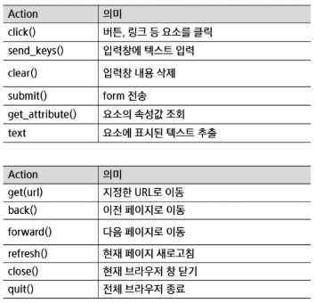
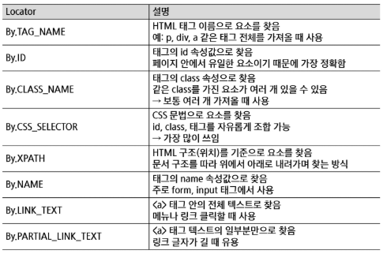
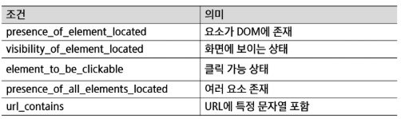

# 10월 12일

# 데이터 수집

## 웹 크롤링
### **웹 크롤링이란?**
- 인터넷 상의 웹 페이지를 자동으로 탐색하고 데이터를 수집하는 기술

### **스크래핑이란?**
- 특정 웹페이지에서 원하는 데이터(텍스트, 이미지, 표 등)를 추출하는 과정

### **웹 크롤링의 특징**
- 자동화
- 대량 데이터 수집
- 구조화된 데이터 추출

### **웹 데이터 수집 방법**
- 웹 페이지를 가져와서 필요한 정보만 추출(스크래핑)
- WebDriver를 이용해 웹 브라우저 자동화하기 (스크래핑 or 크롤링)
- 제공된 OpenAPI를 이용해 실시간으로 데이터 가져오기

### **웹 페이지에서 데이터 추출**
- 웹페이지는 HTML을 중심으로 이루어져 있음
- 원하는 주소의 웹 페이지로 들어가 HTML내용을 가져오고, 그 안에서 원하는 데이터가 어디 있는지 가져오는 작엄 (Parsing)
- Python에는 정적 페이지에서는 BeautifulSoup 라이브러리를 주로 사용한다.

### **WebDriver로 웹 브라우저 자동화**
- 크롬, 파이어폭스, IE등의 웹 브라우저에서 클릭, 텍스트 입력 등의 행동을 코드로 제어 할 수 있게끔 만든 브라우저를 WebDriver라고 함
- 로그인이 필요한 서비스 등 단순 URL만으로는 접속할 수 없는 세션 유지가 필요한 작업이나, 옵션이나 드롭다운 메뉴를 클릭해야 함. 데이터를 얻을 수 있는 작업에 필요함
    - 꼭 크롤링이 아니더라도, 웹 브라우저의 행동을 자동화하는 다른 작업 (게시판에 자동 글쓰기, 새 메일 자동 읽기 등) 에서도 사용 가능
- Python에서는 Selenium 라이브러리를 사용

### **웹 페이지의 구조**
- 웹 페이지는 HTML, CSS, JAVAScript의 조합으로 구성됨
- HTML는 웹 페이지를 구성하는 필수 언어로 제목, 단락, 목록 등과 같은 본문을 윟나 구조적 의미를 나타내는 것 뿐만 아니라 링크, 인용과 그 밖의 항목으로 구조적 문서를 만들 수 있는 방법을 제공
- 웹 크롤링을 통해 얻고자 하는 데이터는 HTML의 어딘가에 들어있음
    - 따라서 어느 정보가 HTML의 어디에 위치하는지를 파악하기 위해, HTML의 구조를 알아야 함.
    - 데이터를 뽑아내는 원하는 형태로 가공하는 작업을 파싱이라 함.
- CSS는 HTML의 요소의 외관을 디자인 함

### **HTML 기본 구성 요소**
```HTML
<html>
    <head>
        <title>
            Test홈페이지
        </title>
    </head>
    <body>
        환영합니다
    </body>
</html>
```

### **HTML 태그 구조**
> <태그이름> 내용 </태그이름>

> <태그이름 속성 = "속성값"> 내용 </태그이름>
- 속성 (attribute) : 태그의 추가적인 정보
- 속성은 여러 개 부여할 수 있다.
- 속성은 없어도 된다.

### **CSS 기본 문법**
> h1 { color : red; }
- 위의 예시처럼 크롤링을 할 때도 선택자(h1)를 사용하여 크롤링을 할 것이다.
- 근데 같은 테그를 사용하는 선택자가 있으면 사용이 불가하다.
- 그럴 때는 아이디를 선택한다.

### **CSS 타입 선택자**
> #item{ color : yellow; }  (아이디 선택자)  
> .item{ color : yellow; }  (클래스 선택자)  
> body > p{ color : blue }  (자식 선택자)  
> ul > li:nth-child(3){ color : yellow; }  (가상 클래스선택자)  

### **Robots.txt 이란?**
- 웹사이트 소유자가 검색 엔진 크롤러에게 사이트의 특정 경로를 크롤링해도 되는지에 대한 권고 규칙을 전달하기 위해 사용하는 표준 텍스트 파일

- 검색 크롤러를 대상으로 한 권고 규칙
- 법적 강제력은 없으며 기술적 차단을 의미하는 것도 아님
- 검색 노출(인덱싱) 범위 제어 목적
- 스크래핑의 합법, 불법 기준은 아님
- robots.txt위반만으로 불법이 되진 않지만 약관 위반, 과도한 수집 등과 결합될 경우 고의적인 자동 수집으로 판단되는 근거로 사용될 수 있음.

## **BeautifulSoup**
### **BeautifulSoup이란?**
- HTML 및 XML 문서를 구문 분석하기 위한 Python 패키지로, 데이터를 쉽게 추출할 수 있도록 도와줌
- 웹 브라우저가 하는 일과 비슷하게, HTML 소스를 트리 형태로 해석한 뒤 접근할 수 있음

### **BeautifulSoup 활용**
- 겉보기엔 별 변화가 없지만, 객체에는 이미 HTML의 정보가 BeautifulSoup을 통해 해석되어있다.

- DOM을 잘 확인하는 것이 중요
- 개발자 도구로 코드를 보면, 메뉴 전체는 ```<table class="menu-table">```
- 요일/식당별 메뉴는 ```<tbody>``` 안의 여러 ```<tr>```로 구성되어있음
- 각 ```<tr>```이 식당 1곳을 의미

- ```<td class="lunch">``` 태그 내부의 텍스트로 구성되어 있음
- 메뉴명, 가격, 운영시간이 별도 태그로 분리되어 있지 않음
- ```<td class="lunch">``` 내부에는 텍스트 노드 ```<br>``` 태그만 존재
- 따라서 이 경우는 ```<td>``` 가운데 해당 클래스를 만족하는 것을 검색하면 점심 메뉴의 리스트를 얻을 수 있음
- ```점심 메뉴 = <td class="lunch">``` 요소의 텍스트" 로 정의할 수 있음
- td.lunch -> 표(td) 중에서 점심 컬럼에 해당하는 셸만 선택

- 이 가운데 학생회관 식당 메뉴만 어등려면, 리스트의 첫 번째 요소를 출력하면 됨
- 첫 번째 td.lunch는 헤더 ('점심' 텍스트) 이므로 실제 메뉴는 두 번째 요소부터 시작
- 태그 객체 안에 들어있는 텍스트만 원한다면, .text 속성을 읽으면 됨
- 이후 후처리는 파이썬 문법을 통해 진행할 수 있음

- 태그의 식별을 위한 속성으로 주오 id와 class 가 사용
- id 는 문서 내에서 유일한 존재이며, class는 중복될 수 있음
- 따라서 이 경우는 ```<td>``` 가운데 해당 클래스를 만족하는 것을 검색하면 점심 메뉴의 리스트를 얻을 수 있음

## **Selenium**
- Selenium은 웹을 파싱하는 도구가 아니라 브라우저를 조종하는 도구
- 정적 페이지를 크롤링하는 경우는 HTML을 받아서 분석하는 방식
- 실제 서비스들은 대부분 자바스크립트로 화면을 그리는 형태
- 크롤링 관점에서 HTML을 가져오는 것으로는 한계가 있어 브라우저를 직접 조작해서 데이터를 가져옴
- 웹 데이터를 수집하는 것 뿐만 아니라 반복작업 자동화 및 웹 어플리케이션 테스트를 용이하게 가능
    - 주소창에 URL 입력
    - 뒤로가기 / 새로고침
    - 버튼 클릭
    - 입력창에 텍스트 입력
    - 화면 스크롤
    - 화면 캡쳐

### **Selenium이 필요한 이유**
- BeautifulSoup은 결국 HTML을 가져와서 파싱하는 역할일 뿐
- Selenium의 핵심은 결국 웹 브라우저를 컨트롤할 수 있다는 것
- 브라우저를 코드로 제어
- 화면에서 보이는 내용이라면 모두 컨트롤 할 수 있음

### **Selenium**
- Action
    - 찾은 요소에 실제로 하는 행동
- Element 대상 Action
    - 요소 (element)에 대한 Action
- Browser 대상 Action (=Navigation)
    - 브라우저 상태 자체를 바꾸는 Action
- Driver
    - driver가 브라우저를 조종하는 컨트롤러 역할
- driver.get("https://www.naver.com")
    - 주소창에 URL을 입력하고 접속하는 것과 동일
    - 웹 페이지 로딩이 완료되면 다음 코드 실행
- driver.refresh()
    - 브라우저의 새로고침(F5)과 동일한 동작
- driver.back()
    - 브라우저의 뒤로 가기 버튼과 동일  



- WebDriverWait
    - 조건이 만족될 때까지 브라우저 동작을 멈추고 기다리는 도구
    - driver : 기다릴 브라우저
    - 10 : 최대 대기 시간(초)
    - 10초 안에 조건이 만족되면 즉시 다음 코드 실행
    - 10초가 지나가도 안 되면 TimeoutException 발생

- Locator
    - 화면에서 특정 요소를 찾는 기준
    - HTML을 분석하는게 아니라 이미 렌더링된 화면에서 요소를 찾음
    - 행동을 하는게 아니라 대상을 지정
  


- ExpectedConditions (EC)
    - 언제까지 기다릴 것인가를 정의하는 조건
    - WebDriverWait은 거의 ExpectedConditions와 거의 함꼐 사용




### **Open API**
- Open API는 누구나 사용할 수 있도록 공개된 API를 말하며, 웹 사이트가 가진 기능을 모두가 이용할 ㅅ ㅜ있도록 공개한 프로그래밍 인터페이스다.
- 많은 서비스 업체 및 공공 기관에서 제공하는 서비스를 외부에서 사용할 수 있게 API를 제공하는 형태
- 대부분 OpenAPI 서비스는 HTTP 프로토콜의 GET, POST 등의 메서드를 사용해 지원이나 서비스를 요청
- OpenAPI에 GET 요청을 보내면 데이터를 정해진 형식의 텍스트로 응답해줌

### **공개된 API 사용하기**
- 만약 기관 등의 서버에서 OpenAPI를 제공하고 있다면, 손쉽게 정제된 형태의 데이터를 가져올 수 있음
- 주로 XML이나 JSON이라는 데이터 형식으로 인코딩 있음

### **공공 데이터 포털의 OpenAPI 사용 절차**
- 사용자 - (API Key) -> 공공 데이터 포털
- 공공 데이터 포털 - (오픈 API 호출) -> 제공 기관
- 제공 기관 - (API 회신) -> 공공 데이터 포털
- 공공 데이터 포털 - (API 결과 응답) -> 사용자

### **공공 데이터 포털의 OpenAPI 활용**
- 먼저 공공데이터 포털에 접속
- 검색창에 관심 주제를 검색한다. 혹은 인기 검색어로 검색
- 분류에서 파일 데이터는 다운로드 가능한 과거 데이터, 오픈 API는 실시간 상황이 반영되는 API를 의미. 오픈 API중 원하는 주제를 선택
- 적절히 활용 목절을 작성하고, 동의 후 활용 신청
- 이후 인증키를 확인. 오픈 API는 서버의 과도한 부담을 막기 위해 인증키를 사용하는 경우가 많음. 동일한 인증키로 과도한 요청이 들어오면 해당 키의 권한이 일시정지 됨.
- 상세페이지로 돌아가면, 요청 변수에 무엇을 입력해야 하는지 설명 되어 있다. 샘플 데이터의 입력 방식을 참고하여 GET 요청을 보내면 된다. 필수 항목은 반드시 입력하고, 옵션 항목은 GET에 포함시키지 않아도 된다.

### **실시간 API 활용**
- 요청 시점의 현재 상태 데이터를 제공하는 API
- 정적 데이터 조회가 아니라, 계속 변하는 데이터를 다룸
- 서버에서는 수초에서 수십초 단위로 계속 갱신
- 사용자가 새로고침하거나, 앱이 주기적으로 API를 호출해서 업데이트

- OpenAPI는 보통 REST 기반 HTTP 요청/응답 모델 요청하면 그 시점의 상태를 돌려주는 형태
- 대부분의 OpenAPI는 이벤트를 받는 구조가 아니라, 우리가 주기적으로 호출해서 상태를 확인하는 Polling 구조로 사용
- Webhook, Websocket 등의 방식은 이벤트 기반 방식의 실시간 API 형태로 형태가 다름

